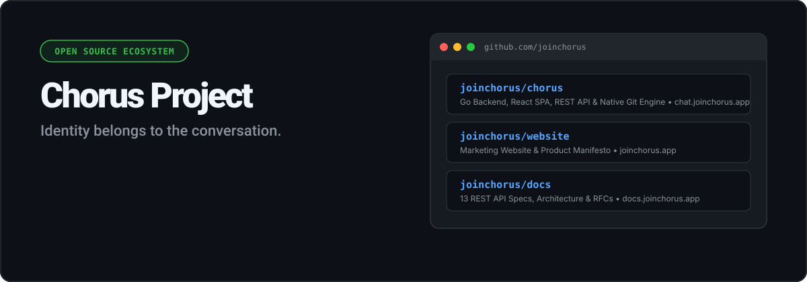

<p align="center">
  
</p>

<p align="center">
  <a href="LICENSE"></a>
  <a href="https://go.dev"></a>
  <a href="https://react.dev"></a>
  <a href="https://git-scm.com"></a>
  <a href="https://github.com/joinchorus"></a>
</p>

<h3 align="center">Identity belongs to the conversation. Not to the person.</h3>

---

Chorus is an open-source anonymous discussion platform where identity is scoped to individual conversations instead of user accounts. It eliminates persistent profile tracking, algorithm-driven feeds, and social media mechanics in favor of thoughtful, chronological discourse.

---

## 🏛️ Ecosystem Architecture

```
joinchorus.app (Website)       --> Firebase Hosting     --> joinchorus/website repository
docs.joinchorus.app (Docs)     --> Firebase Hosting     --> joinchorus/docs repository
chat.joinchorus.app (App API)  --> Firebase App Hosting --> joinchorus/chorus repository
```

---

## 📦 Canonical Repositories

### 1. 💬 [Application (`chorus`)](https://github.com/joinchorus/chorus)
- **Live Application:** [chat.joinchorus.app](https://chat.joinchorus.app)
- **Deployment:** Firebase App Hosting (`apphosting.yaml`)
- **Core Tech:** Go 1.22+, React 18, Vite, Native Git commit audit engine (`internal/gitstore`)

### 2. 📖 [Documentation (`docs`)](https://github.com/joinchorus/docs)
- **Live Portal:** [docs.joinchorus.app](https://docs.joinchorus.app)
- **Deployment:** Firebase Hosting (`firebase.json`)
- **Core Tech:** 13 REST API Endpoint Specifications, 8-Layer SVG Architecture Diagram, 9-Stage Request Lifecycle SVG, RFCs

### 3. 🌐 [Website (`website`)](https://github.com/joinchorus/website)
- **Live Site:** [joinchorus.app](https://joinchorus.app)
- **Deployment:** Firebase Hosting (`firebase.json`)
- **Core Tech:** Editorial Product Manifesto, Apple/Linear visual style, Dark/Light Mode

---

## 🤝 Community & Security

- **Security Policy:** [SECURITY.md](https://github.com/joinchorus/chorus/blob/main/SECURITY.md)
- **Contributing Guidelines:** [CONTRIBUTING.md](https://github.com/joinchorus/chorus/blob/main/CONTRIBUTING.md)
- **Code of Conduct:** [CODE_OF_CONDUCT.md](https://github.com/joinchorus/chorus/blob/main/CODE_OF_CONDUCT.md)

---

## 📄 License

All Chorus repositories are open source and distributed under the [MIT License](LICENSE).
