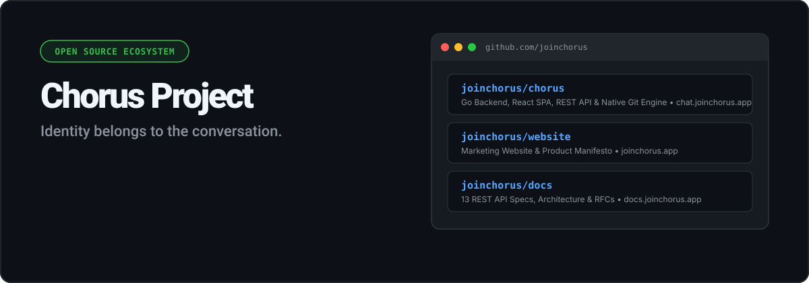

  

  <a href="https://chat.joinchorus.app"><b>Live demo</b></a> ·
  <a href="https://joinchorus.app">Website</a> ·
  <a href="https://docs.joinchorus.app">Docs</a> ·
  <a href="https://github.com/joinchorus/chorus/discussions">Discussions</a>

## Who we are

Chorus is an open-source project from Türkiye. We are building an anonymous discussion engine with no accounts, no profiles, no likes and no ranking. Each conversation gives every participant a temporary name that exists only in that conversation, and nothing follows you out of it.

Everything here is early development (`chorus` is v0.1.0-alpha) and MIT licensed. Expect rough edges.

## What we build

  

| Repository | What it is | Live |
| :--- | :--- | :--- |
| [`chorus`](https://github.com/joinchorus/chorus) | The anonymous discussion engine: a Go 1.22 standard-library backend and a React 19.2 / Vite 8 app | [chat.joinchorus.app](https://chat.joinchorus.app) |
| [`docs`](https://github.com/joinchorus/docs) | REST API reference (7 documented endpoints), architecture and write-lifecycle diagrams, and RFC-001 on Git persistence | [docs.joinchorus.app](https://docs.joinchorus.app) |
| [`website`](https://github.com/joinchorus/website) | The manifesto site | [joinchorus.app](https://joinchorus.app) |

## How it works

Every thread and message is a JSON file that is committed to a local Git repository, so the history is plain, append-only Git history you can read with ordinary Git tools. Moderation removals are hidden when a thread is read but stay in that history. Names are scoped to a thread, and threads are read in chronological order.

## Contribute

Start with the [contributing guide](https://github.com/joinchorus/.github/blob/main/CONTRIBUTING.md); `docs` and `website` have their own repository-specific guides. Everyone taking part is expected to follow the [Code of Conduct](https://github.com/joinchorus/.github/blob/main/CODE_OF_CONDUCT.md).

## Security

Please do not open a public issue for a vulnerability. Use [private vulnerability reporting](https://github.com/joinchorus/chorus/security/advisories/new), which is enabled on every repository, and read the [security policy](https://github.com/joinchorus/.github/blob/main/SECURITY.md).

## Community and support

Ask questions and share ideas in [Discussions](https://github.com/joinchorus/chorus/discussions). See [SUPPORT.md](https://github.com/joinchorus/.github/blob/main/SUPPORT.md) for where to get help.

Maintained by [Barış Salih Babacan](https://github.com/barissalihbabacan) and [Mehmet Emin Dereci](https://github.com/MEmin00) (original concept).
